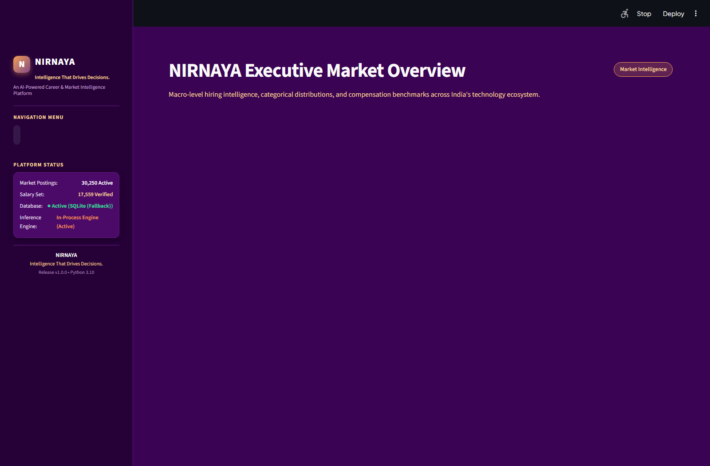
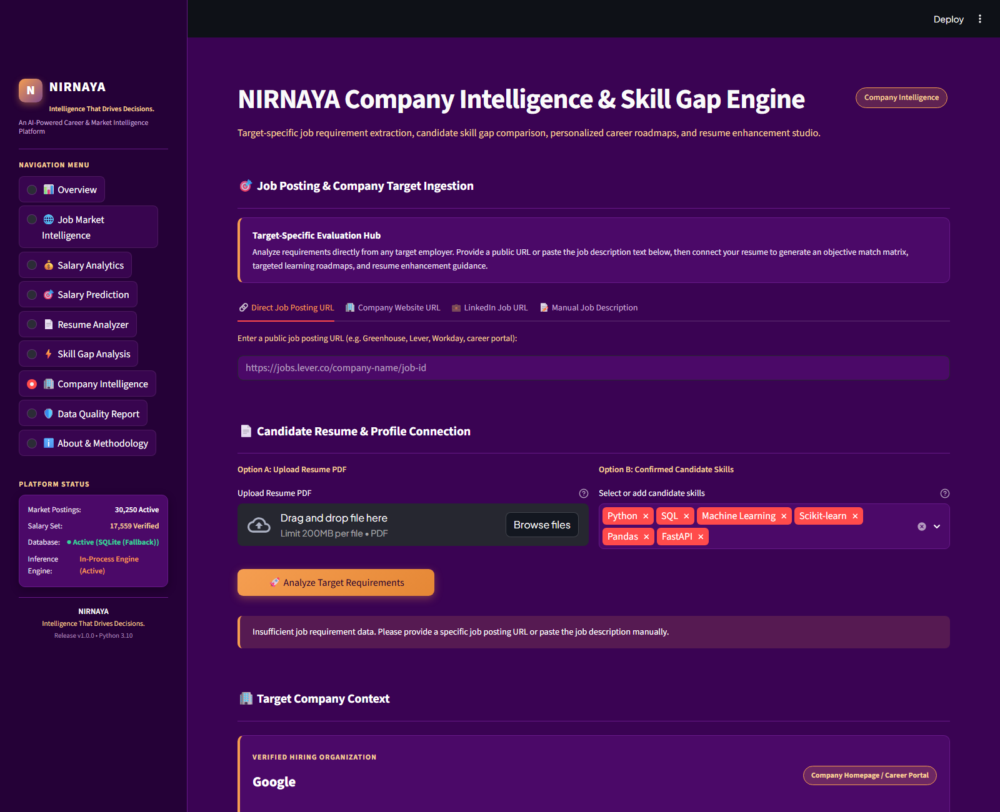
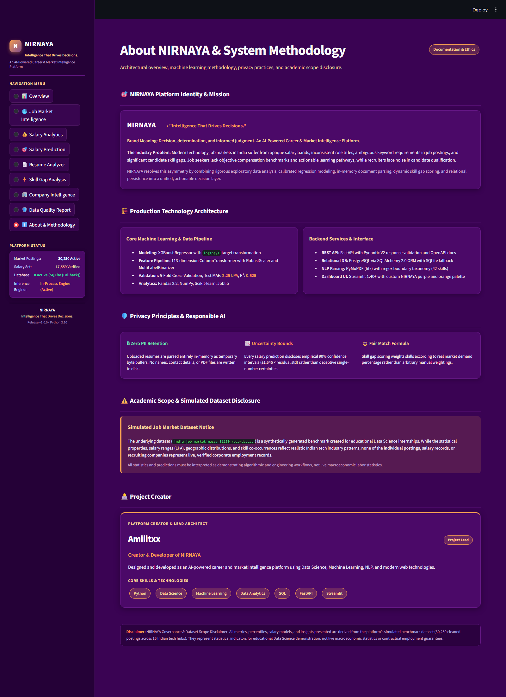

# NIRNAYA — AI-Powered Career & Market Intelligence Platform

> **"Intelligence That Drives Decisions."**  
> *An AI-Powered Career & Market Intelligence Platform by Amiiitxx*

[](https://www.python.org/downloads/)
[](https://fastapi.tiangolo.com/)
[](https://streamlit.io/)
[](https://scikit-learn.org/)
[](https://xgboost.readthedocs.io/)
[]()
[](LICENSE)

---

## 1. Executive Summary

**NIRNAYA** (meaning *Decision, Determination, and Informed Judgment*) is a production-grade Data Science, Machine Learning, and NLP platform engineered to analyze the technology employment landscape in India.

The platform combines macro market intelligence across 30,250 technology job postings, calibrated machine learning salary prediction models, an ephemeral in-memory PDF resume parser, a demand-weighted skill gap analyzer, and a target-specific **Company Intelligence Engine** with hardened SSRF protection, anti-hallucination guarantees, and 30-60-90 day learning roadmaps.

The system is delivered through:
1. **Interactive SaaS Dashboard:** A Streamlit application styled in NIRNAYA's deep purple and orange palette (`#3A0353`, `#804A8A`, `#F59E51`, `#F8D299`).
2. **RESTful Microservice:** A high-throughput FastAPI backend serving 9 analytical and prediction endpoints with Swagger UI.
3. **Relational Database Layer:** SQLAlchemy 2.0 ORM with PostgreSQL support and automated SQLite fallback.
4. **Machine Learning Pipeline:** Tuned XGBoost Regressor with 113 encoded features, logarithmic target formulation, and empirical 90% confidence intervals.

---

## 2. Platform Architecture

```
┌────────────────────────────────────────────────────────────────────────┐
│                   NIRNAYA STREAMLIT SAAS DASHBOARD                     │
│  [Overview] [Job Market] [Salary] [Resume] [Skill Gap] [Company Intel] │
└───────────────────┬────────────────────────────────┬───────────────────┘
                    │                                │
                    ▼                                ▼
┌──────────────────────────────────────┐  ┌──────────────────────────────┐
│       FASTAPI REST BACKEND           │  │   IN-MEMORY RESUME PARSER    │
│  • 9 Market & Prediction Endpoints   │  │   • PyMuPDF Byte Streaming   │
│  • OpenAPI / Swagger Documentation   │  │   • Zero Permanent PII / Disk│
│  • Parameterized Pydantic Schemas    │  │   • 42-Skill Regex Taxonomy  │
└───────────────────┬──────────────────┘  └──────────────┬───────────────┘
                    │                                    │
                    ▼                                    ▼
┌──────────────────────────────────────┐  ┌──────────────────────────────┐
│      PERSISTENCE & DATABASE          │  │  COMPANY INTELLIGENCE ENGINE │
│  • SQLAlchemy 2.0 ORM                │  │  • SSRF Hardened Ingestion   │
│  • SQLite (Default) / PostgreSQL     │  │  • 4 Ingestion Input Modes   │
│  • Idempotent Deduplicated Ingestion │  │  • Anti-Hallucination Policy │
│  • 30,250 Postings & 16 Tech Hubs    │  │  • 30-60-90 Day Roadmaps     │
└───────────────────┬──────────────────┘  │  • Google XYZ Resume Studio  │
                    │                     └──────────────┬───────────────┘
                    ▼                                    │
┌────────────────────────────────────────────────────────┴───────────────┐
│              SUPERVISED MACHINE LEARNING INFERENCE                     │
│  • Tuned XGBoost Regressor (log(1+y) Formulation, R² = 0.6250)         │
│  • 113 Features: RobustScaler, One-Hot Encoding, MultiLabelBinarizer   │
│  • Empirical 90% Confidence Intervals (±1.645 · s_resid)               │
└────────────────────────────────────────────────────────────────────────┘
```

---

## 3. Key Capabilities & Modules

### 🏢 Module 7: Company Intelligence & Skill Gap Engine (NEW)
- **4 Input Ingestion Modes:** Supports Direct Job Posting URLs (Lever, Greenhouse, Workday), Company Careers Portals, LinkedIn Job URLs (with graceful auth-wall handling), and Manual Job Description Text.
- **SSRF Defense Engine:** Protocol restrictions (HTTP/HTTPS only), DNS resolution inspection, blocking of loopback (`127.0.0.0/8`, `::1`), RFC 1918 private subnets, cloud metadata endpoints (`169.254.169.254`, `100.100.100.200`), carrier-grade NAT (`100.64.0.0/10`), unsafe ports, and streaming 2.5 MB payload limits.
- **Strict Anti-Hallucination Policy:** Clearly distinguishes generic company homepages (e.g., `careers.google.com`) from specific job postings. Preserves verified organization names while suppressing false role assumptions, ungrounded skills, or fake roadmaps.
- **Categorized Comparison Matrix:** Deterministic classification into `Matched`, `Missing`, `Partially Matched`, and `Needs Verification` with a 70/30 demand-weighted match formula.
- **Ethical Resume Studio:** Enhances bullets using the Google XYZ formula (`"Accomplished [X] as measured by [Y], by doing [Z]"`) with candidate placeholders, without fabricating achievements.
- **Actionable Roadmaps:** Dynamic 30-day (foundations), 60-day (core projects), and 90-day (portfolio capstone) milestone pathways.

### 💰 Module 3: Supervised Salary Prediction Pipeline
- **Logarithmic Target Formulation:** Trained on $\log(1+y)$ (`salary_mid_lpa`), mitigating right-skewness and improving model generalization.
- **Feature Space:** 113 encoded features combining `RobustScaler` on continuous features (`experience_years`, `skill_count`), one-hot encoding on categorical attributes (`clean_role`, `city`, `education`, `work_mode`, `company_size`), and `MultiLabelBinarizer` on the top 25 technical skills.
- **Champion Model:** Tuned XGBoost Regressor achieving **Test $R^2 = 0.6250$, Test MAE = 2.25 LPA, Test RMSE = 4.55 LPA**.
- **Confidence Intervals:** Generates empirical $90\%$ prediction intervals ($\hat{y} \pm 1.645 \cdot s_{\text{resid}}$).

### 📄 Module 4: In-Memory Resume Parser
- **Zero Disk Retention:** Resumes are processed strictly in RAM via byte streams using PyMuPDF (`fitz`).
- **Section Segmentation:** Detects 5 standard sections: `skills`, `experience`, `projects`, `education`, and `certifications`.
- **Word-Boundary Regex Taxonomy:** Matches 42 canonical technical skills while avoiding false positive substring triggers.
- **OCR Handling:** Flags image-only/scanned documents with clear guidance.

### ⚡ Module 5: Market-Level Skill Gap Analyzer
- **Demand Weighting Formula:**
  $$\text{Match Score} = \left( \frac{\sum_{s \in \text{Candidate} \cap \text{Role}} \text{Demand}(s)}{\sum_{s \in \text{Role}} \text{Demand}(s)} \right) \times 100$$
- **Priority Tiering:** Classifies missing skills into **Essential** ($\ge 50\%$), **Important** ($25–50\%$), and **Additional** ($< 25\%$).

### 🌐 Module 6: Macro Market Intelligence & Database Layer
- **Market Scope:** 30,250 validated postings across 16 hiring companies, 12 canonical roles, and 16 Indian tech hubs.
- **Persistence:** SQLAlchemy 2.0 ORM models (`Company`, `Skill`, `JobPosting`, `JobSkill`) with duplicate prevention.
- **FastAPI Endpoints:** 9 high-throughput endpoints serving market overviews, role dossiers, city dossiers, salary quartiles, and trends.

---

## 4. Visual Showcase

The dashboard utilizes NIRNAYA's purple and orange design system:

| View | Screenshot |
| :--- | :--- |
| **Executive Overview** |  |
| **Company Intelligence Engine** |  |
| **Generic Homepage Detection** |  |
| **About & Creator Profile** |  |

---

## 5. Technology Stack

- **Core Language:** Python 3.10+
- **Machine Learning & Modeling:** Scikit-learn 1.5, XGBoost 2.0+, Joblib
- **Data Engineering & Manipulation:** Pandas 2.2, NumPy 1.26
- **NLP & Document Parsing:** PyMuPDF (`fitz`), Python `re`
- **Web Scraping & Security:** Requests, Urllib3, `ipaddress` (SSRF Defense)
- **Web Framework & API:** FastAPI 0.104+, Pydantic V2, Uvicorn
- **Interactive UI & Dashboards:** Streamlit 1.40+, Plotly Express & Graph Objects
- **Database & Persistence:** SQLAlchemy 2.0, SQLite (default), PostgreSQL (supported)
- **Testing & Quality Assurance:** Pytest 8.4, AnyIO, HTTPX

---

## 6. Project Directory Structure

```
nirnaya/
├── api/
│   ├── __init__.py
│   └── main.py                     # FastAPI application & 9 REST endpoints
├── dashboard/
│   ├── app.py                      # Streamlit application entrypoint & dynamic router
│   ├── data_loader.py              # Centralized data loader & cached factories
│   ├── assets/
│   │   └── style.css               # NIRNAYA purple & orange design system
│   ├── components/                 # Reusable UI components (cards, charts, filters, sidebar)
│   └── pages/                      # 9 Modular Streamlit views
│       ├── overview.py
│       ├── job_market.py
│       ├── salary_analytics.py
│       ├── salary_prediction.py
│       ├── resume_analyzer.py
│       ├── skill_gap.py
│       ├── company_intelligence.py # Module 7: Target-specific company engine
│       ├── data_quality.py
│       └── about.py                # About & Creator (Amiiitxx) profile
├── data/
│   ├── raw/                        # Original raw dataset
│   │   └── india_job_market_messy_31150_records.csv
│   └── processed/                  # Cleaned benchmark datasets
│       ├── cleaned_job_market_all.csv      (30,250 records)
│       └── cleaned_salary_model_data.csv   (17,559 records)
├── database/
│   ├── db.py                       # SQLAlchemy 2.0 ORM models & session management
│   └── load_data.py                # Idempotent batch ingestion script
├── models/                         # Serialized ML artifacts (< 1 MB total)
│   ├── best_salary_model.joblib
│   ├── salary_prediction_pipeline.joblib
│   ├── feature_pipeline.joblib
│   ├── feature_metadata.json
│   ├── model_metadata.json
│   ├── model_comparison.csv
│   └── feature_importance.csv
├── notebooks/                      # 8 Documented research & EDA Jupyter notebooks
├── reports/
│   ├── figures/                    # 300 DPI publication charts
│   ├── screenshots/                # Real captured dashboard screenshots
│   └── company_intelligence_report.md
├── scripts/
│   ├── capture_screenshots.py      # CDP screenshot automation script
│   ├── inspect_modules.py          # Module diagnostic tool
│   └── test_dashboard_runtime.py   # Live CDP browser verification script
├── src/
│   ├── company_intelligence/       # Isolated Module 7 package
│   │   ├── __init__.py
│   │   ├── validators.py           # SSRF security defense layer
│   │   ├── job_extractor.py        # Safe HTTP fetching & HTML cleaning
│   │   ├── requirement_parser.py   # Job posting & taxonomy parser
│   │   ├── candidate_comparator.py # 70/30 Demand-weighted comparison
│   │   ├── recommendation_engine.py# Priority learning assignments
│   │   ├── resume_improver.py      # Google XYZ ethical resume studio
│   │   ├── roadmap_generator.py    # Phased 30-60-90 day pathways
│   │   └── company_analyzer.py     # End-to-end orchestrator
│   ├── preprocessing.py            # Data cleaning & normalization
│   ├── feature_engineering.py      # ColumnTransformer feature pipeline
│   ├── salary_model.py             # Salary prediction regressor & inference
│   ├── resume_parser.py            # PyMuPDF in-memory text & skill extraction
│   ├── skill_analyzer.py           # Market-level skill gap analyzer
│   └── job_market_intelligence.py  # Analytical querying engine
├── tests/                          # 10 test suites (121 tests total)
│   ├── test_api.py
│   ├── test_company_intelligence.py# 35 Company intelligence tests
│   ├── test_dashboard.py
│   ├── test_database.py
│   ├── test_feature_engineering.py
│   ├── test_job_market_intelligence.py
│   ├── test_preprocessing.py
│   ├── test_resume_parser.py
│   ├── test_salary_model.py
│   └── test_skill_analyzer.py
├── .env.example                    # Sanitized environment configuration template
├── .gitignore                      # Comprehensive exclusion rules
├── requirements.txt                # Pinned production dependencies
└── README.md                       # Master platform documentation
```

---

## 7. Installation & Quickstart

### 7.1 Clone and Environment Setup
```bash
# Clone the repository
git clone https://github.com/your-username/nirnaya.git
cd nirnaya

# Create and activate a virtual environment
python -m venv venv

# Windows:
.\venv\Scripts\Activate.ps1

# Linux / macOS:
source venv/bin/activate

# Install dependencies
pip install -r requirements.txt
```

### 7.2 Configuration
Copy the sanitized environment configuration template:
```bash
# Windows
copy .env.example .env

# Linux / macOS
cp .env.example .env
```
*Note: The platform defaults to a local SQLite database (`sqlite:///./data/job_market.db`). If you prefer PostgreSQL, set your connection string in `.env`.*

### 7.3 Database Initialization (Optional)
The application works immediately out-of-the-box using the verified processed CSV datasets. To optionally populate the SQLite or PostgreSQL database:
```bash
# Initialize schema tables
python -c "from database.db import init_db; init_db()"

# Ingest the 30,250 records
python database/load_data.py
```

---

## 8. Running the Application

### Launch the Streamlit SaaS Dashboard
```bash
streamlit run dashboard/app.py
```
Open your browser at `http://localhost:8501`.

### Launch the FastAPI Microservice
```bash
uvicorn api.main:app --host 127.0.0.1 --port 8000 --reload
```
View the interactive Swagger documentation at `http://127.0.0.1:8000/docs`.

---

## 9. Running Tests

Execute the complete automated test suite (121 tests):
```bash
pytest -v
```

Execute only the Company Intelligence & SSRF test suite:
```bash
pytest -v tests/test_company_intelligence.py
```

Execute dashboard integration tests:
```bash
pytest -v tests/test_dashboard.py
```

---

## 10. Model Performance Summary

| Metric | Tuned XGBoost ($\log(1+y)$) | Linear Regression ($\log(1+y)$) | Raw Linear Regression |
| :--- | :---: | :---: | :---: |
| **Test $R^2$** | **0.6250** | 0.6222 | 0.5917 |
| **Test MAE** | **2.25 LPA** | 2.24 LPA | 2.53 LPA |
| **Test RMSE** | **4.55 LPA** | 4.57 LPA | 4.75 LPA |
| **Confidence Interval** | **$\pm 7.45$ LPA (90%)** | $\pm 7.51$ LPA (90%) | $\pm 7.81$ LPA (90%) |

---

## 11. Security, Privacy & Responsible AI

- **In-Memory Resume Processing:** Resumes are parsed strictly in RAM via byte streams using PyMuPDF; no candidate CVs, contact details, or PII are stored on disk.
- **SSRF Hardened Architecture:** Ingested URLs are strictly validated against private subnets (RFC 1918), loopback interfaces, cloud metadata endpoints (AWS, GCP, Azure, Alibaba), and carrier-grade NAT before socket connection.
- **Anti-Hallucination Policy:** The platform never fabricates achievements or invents company requirements. When requirements are missing or when a generic homepage is supplied, the system alerts the user and suppresses false predictions.
- **Google XYZ Resume Structure:** Recommended bullet points use candidate placeholders (`"Accomplished [X] as measured by [Y], by doing [Z]"`) for ethical career guidance.
- **SQL Injection Prevention:** All database operations utilize parameterized SQLAlchemy ORM statements.

---

## 12. Project Creator

**Amiiitxx**  
*Creator & Developer of NIRNAYA*  
Designed and developed as an AI-powered career and market intelligence platform using Data Science, Machine Learning, NLP, and modern web technologies.

---

## 13. License

This project is licensed under the [MIT License](LICENSE) — free for educational, academic, and professional evaluation.
