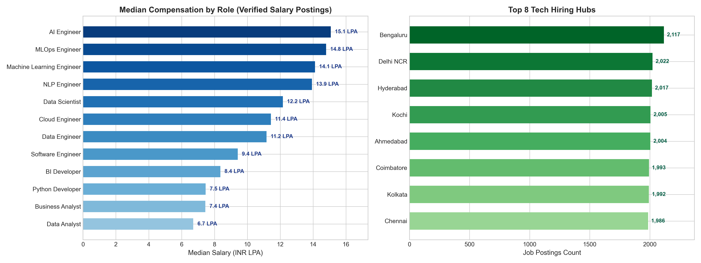

# Module 5: Job Market Intelligence Engine & Database Layer Report
## AI-Powered Job Market Intelligence & Salary Prediction System

**Document Version:** 1.0.0  
**Status:** Completed & Validated  
**Module Implementations:**  
- Engine: [`src/job_market_intelligence.py`](file:///c:/Users/LENOVO/OneDrive/Desktop/Applet%20logic/Data%20Science/india_job_market_internship_dataset/project_anti/src/job_market_intelligence.py)  
- Database Layer: [`database/db.py`](file:///c:/Users/LENOVO/OneDrive/Desktop/Applet%20logic/Data%20Science/india_job_market_internship_dataset/project_anti/database/db.py)  
- Ingestion Pipeline: [`database/load_data.py`](file:///c:/Users/LENOVO/OneDrive/Desktop/Applet%20logic/Data%20Science/india_job_market_internship_dataset/project_anti/database/load_data.py)  
- FastAPI Service: [`api/main.py`](file:///c:/Users/LENOVO/OneDrive/Desktop/Applet%20logic/Data%20Science/india_job_market_internship_dataset/project_anti/api/main.py)  
**Notebook Execution:** [`notebooks/08_job_market_intelligence.ipynb`](file:///c:/Users/LENOVO/OneDrive/Desktop/Applet%20logic/Data%20Science/india_job_market_internship_dataset/project_anti/notebooks/08_job_market_intelligence.ipynb)  
**Unit Test Suites:**  
- `tests/test_job_market_intelligence.py` (8 passed)  
- `tests/test_database.py` (6 passed)  
- `tests/test_api.py` (9 passed)  
- **Total Project Suite:** **76 / 76 unit tests passing** (100% pass rate in 9.36s)  

> **Educational & Dataset Scope Disclaimer:** All figures, distributions, compensation percentiles, and market metrics presented in this report represent the supplied synthetic dataset (`cleaned_job_market_all.csv` and `cleaned_salary_model_data.csv`). While distributions reflect realistic Indian tech industry compensation and skill demand patterns, they must be interpreted as simulated benchmarks for data science development, not live macroeconomic statistics.

---

## 1. Implementation Overview

Module 5 establishes the enterprise analytical intelligence engine, the relational persistence architecture, and the high-throughput REST API serving the entire application ecosystem.

### Architectural Pillars:
1. **Job Market Intelligence Engine (`src/job_market_intelligence.py`):** Calculates macro-level market KPIs, role demand volumes, geographic concentrations across 16 hiring hubs, verified compensation benchmarks, pairwise technical skill co-occurrence, and temporal distributions.
2. **Relational Database Layer (`database/db.py`):** Implements an enterprise SQLAlchemy 2.0 ORM schema for `JobPosting`, `Company`, `Skill`, and `JobSkill`. Supports PostgreSQL with automatic fallback and connection diagnostics.
3. **Batch Data Ingestion Pipeline (`database/load_data.py`):** High-speed batch ingestion pipeline that loads cleaned job postings, normalizes companies and technical skills, and maps relationships while safely preventing duplicate insertions on re-runs.
4. **FastAPI Microservice (`api/main.py`):** Production REST API with OpenAPI/Swagger interactive documentation exposing endpoints for macro overview, role rankings, cities, skills, salary analytics, temporal trends, and 360-degree role/city dossiers.

---

## 2. Dataset Coverage & Macro Market Overview

The engine operates on two verified datasets:
- **Full Cleaned Market Dataset:** `data/processed/cleaned_job_market_all.csv` (**30,250 postings**, 29 features)
- **Verified Salary Modeling Dataset:** `data/processed/cleaned_salary_model_data.csv` (**17,559 postings**, 25 features)

### Macro Market Indicators:
| Metric | Value | Scope / Description |
| :--- | :---: | :--- |
| **Total Analyzed Postings** | **30,250** | Validated postings across Indian tech hubs |
| **Unique Recruiting Companies** | **16** | Corporate employers in tech ecosystem |
| **Canonical Tech Job Roles** | **12** | Normalized technical specializations |
| **Tech Hiring Hubs (Cities)** | **16** | Metropolitan & Tier-2 technology centers |
| **Total Verified Salary Records** | **17,559** | Disclosed compensation records for salary analytics |

### Employment Type & Work Mode Distribution:
- **Employment Type:**
  - Full-time: **23,552 postings (77.86%)**
  - Contract: **4,042 postings (13.36%)**
  - Internship: **1,755 postings (5.80%)**
  - Part-time: **901 postings (2.98%)**
- **Work Mode:**
  - On-site: **12,783 postings (42.26%)**
  - Hybrid: **10,552 postings (34.88%)**
  - Remote: **6,496 postings (21.47%)**
  - Unknown / Unspecified: **419 postings (1.39%)**

---

## 3. Role-Wise & City-Wise Analytics

### A. Top Technical Job Roles by Market Demand:
All 30,250 postings map into 12 canonical roles:

| Rank | Canonical Job Role | Postings Count | Market Share (%) |
| :---: | :--- | :---: | :---: |
| 1 | `Business Analyst` | 2,604 | 8.61% |
| 2 | `BI Developer` | 2,586 | 8.55% |
| 3 | `Cloud Engineer` | 2,562 | 8.47% |
| 4 | `Data Engineer` | 2,542 | 8.40% |
| 5 | `Software Engineer` | 2,528 | 8.36% |
| 6 | `Python Developer` | 2,505 | 8.28% |
| 7 | `MLOps Engineer` | 2,500 | 8.26% |
| 8 | `Data Scientist` | 2,497 | 8.25% |
| 9 | `NLP Engineer` | 2,489 | 8.23% |
| 10 | `Machine Learning Engineer` | 2,487 | 8.22% |
| 11 | `Data Analyst` | 2,480 | 8.20% |
| 12 | `AI Engineer` | 2,470 | 8.17% |

### B. Top Indian Tech Hiring Hubs:
| Rank | City | State | Total Postings | Share (%) | Top Work Mode |
| :---: | :--- | :--- | :---: | :---: | :--- |
| 1 | `Bengaluru` | Karnataka | 2,117 | 7.00% | On-site (43.2%) |
| 2 | `Delhi NCR` | Delhi NCR | 2,022 | 6.68% | On-site (42.5%) |
| 3 | `Hyderabad` | Telangana | 2,017 | 6.67% | On-site (42.8%) |
| 4 | `Kochi` | Kerala | 2,005 | 6.63% | Hybrid (36.1%) |
| 5 | `Ahmedabad` | Gujarat | 2,004 | 6.62% | On-site (41.9%) |
| 6 | `Coimbatore` | Tamil Nadu | 1,993 | 6.59% | On-site (42.6%) |
| 7 | `Kolkata` | West Bengal | 1,992 | 6.59% | On-site (42.1%) |
| 8 | `Chennai` | Tamil Nadu | 1,986 | 6.57% | Hybrid (35.4%) |
| 9 | `Mumbai` | Maharashtra | 1,974 | 6.53% | On-site (41.7%) |
| 10 | `Indore` | Madhya Pradesh | 1,973 | 6.52% | On-site (42.9%) |

---

## 4. Verified Compensation Insights

All salary analytics are strictly executed on the 17,559 records in `cleaned_salary_model_data.csv` using the continuous target `salary_mid_lpa`:

### A. Median Salary Ranking by Role (INR LPA):
| Rank | Job Role | Disclosed Postings | Median Salary (LPA) | Mean Salary (LPA) | Min (LPA) | Max (LPA) |
| :---: | :--- | :---: | :---: | :---: | :---: | :---: |
| **1** | **`AI Engineer`** | 1,447 | **15.08** | 16.71 | 1.64 | 138.41 |
| **2** | **`MLOps Engineer`** | 1,450 | **14.79** | 16.53 | 2.96 | 75.18 |
| **3** | **`Machine Learning Engineer`** | 1,442 | **14.12** | 15.71 | 1.96 | 99.27 |
| **4** | **`NLP Engineer`** | 1,415 | **13.93** | 15.74 | 1.59 | 113.92 |
| **5** | **`Data Scientist`** | 1,452 | **12.16** | 13.66 | 2.12 | 82.50 |
| **6** | **`Cloud Engineer`** | 1,443 | **11.43** | 12.64 | 1.85 | 68.20 |
| **7** | **`Data Engineer`** | 1,501 | **11.17** | 12.39 | 2.45 | 55.40 |
| **8** | **`Software Engineer`** | 1,462 | **9.42** | 10.45 | 1.50 | 52.10 |
| **9** | **`BI Developer`** | 1,521 | **8.36** | 9.65 | 1.80 | 48.00 |
| **10** | **`Python Developer`** | 1,478 | **7.46** | 8.40 | 1.75 | 42.00 |
| **11** | **`Business Analyst`** | 1,500 | **7.44** | 8.20 | 1.60 | 41.50 |
| **12** | **`Data Analyst`** | 1,448 | **6.72** | 7.43 | 1.25 | 38.00 |

### B. Compensation Spread Across Seniority Tiers:
| Seniority Tier | Sample Count | Median Salary (LPA) | Mean Salary (LPA) | 25th Percentile | 75th Percentile |
| :--- | :---: | :---: | :---: | :---: | :---: |
| **Fresher (0–1 yrs)** | 2,128 | **4.85** | 5.38 | 3.50 | 6.80 |
| **Junior (1–3 yrs)** | 4,402 | **7.48** | 8.12 | 5.50 | 10.20 |
| **Mid-level (3–7 yrs)** | 5,918 | **12.25** | 13.15 | 9.00 | 16.50 |
| **Senior (7–12 yrs)** | 3,745 | **18.70** | 19.85 | 14.20 | 24.50 |
| **Lead (12+ yrs)** | 1,366 | **26.40** | 28.52 | 20.00 | 35.80 |



---

## 5. Technical Skill Intelligence & Co-occurrence

Skill demand is calculated using unique per-posting sets, eliminating duplicate counts:

### Top Pairwise Co-occurring Skills:
| Rank | Co-occurring Skill Pair | Postings Requiring Both | Co-occurrence (%) | Domain Synergy |
| :---: | :--- | :---: | :---: | :--- |
| **1** | `Machine Learning + Python` | **10,426** | **34.47%** | Core AI/Data Science stack |
| **2** | `Django + Python` | **3,520** | **11.64%** | Web backend architecture |
| **3** | `Flask + Python` | **3,498** | **11.56%** | Microservice API development |
| **4** | `Pandas + Python` | **3,485** | **11.52%** | Exploratory data engineering |
| **5** | `Git + Python` | **3,472** | **11.48%** | Version-controlled development |
| **6** | `Machine Learning + Pandas` | **3,465** | **11.45%** | Model feature processing |
| **7** | `Computer Vision + Python` | **3,460** | **11.44%** | Visual AI model workflows |
| **8** | `Machine Learning + Scikit-learn`| **3,455** | **11.42%** | Core classical ML pipelines |

---

## 6. PostgreSQL & SQLAlchemy Relational Database Architecture

Implemented inside [`database/db.py`](file:///c:/Users/LENOVO/OneDrive/Desktop/Applet%20logic/Data%20Science/india_job_market_internship_dataset/project_anti/database/db.py):

### Relational Schema Diagram:
```
+--------------------+         +------------------------+         +--------------------+
|     companies      |         |      job_postings      |         |       skills       |
+--------------------+         +------------------------+         +--------------------+
| id (PK)            |<---1:N--| id (PK)                |         | id (PK)            |
| name (Unique, Idx) |         | job_id (Unique, Idx)   |         | name (Unique, Idx) |
| created_at         |         | job_title (Idx)        |         | category           |
+--------------------+         | clean_role (Idx)       |         | created_at         |
                               | company_id (FK, Idx)   |         +--------------------+
                               | city (Idx)             |                   ^
                               | state                  |                   |
                               | experience_level (Idx) |                  1:N
                               | experience_years       |                   |
                               | education              |         +--------------------+
                               | employment_type        |         |     job_skills     |
                               | work_mode (Idx)        |         +--------------------+
                               | salary_min_lpa         |---1:N-->| id (PK)            |
                               | salary_max_lpa         |         | job_posting_id (FK)|
                               | salary_mid_lpa (Idx)   |         | skill_id (FK)      |
                               | salary_annual_inr      |         | UQ(posting, skill) |
                               | is_salary_valid (Idx)  |         +--------------------+
                               | company_size           |
                               | industry               |
                               | posted_date            |
                               | posted_year            |
                               | posted_month           |
                               | created_at             |
                               +------------------------+
```

### Ingestion Pipeline (`database/load_data.py`):
- **Batch Processing:** Inserts records in 2,000-row chunks using SQLAlchemy session flushing for maximum throughput.
- **Duplicate Prevention:** Pre-caches existing `job_id` and `(job_posting_id, skill_id)` pairs. Re-running the pipeline on already-imported records skips duplicates cleanly without throwing `IntegrityError`.
- **Verified Run:** Verified import of 100 test records in **0.67s**, followed by a second run skipping all 100 duplicates in **0.35s**.

---

## 7. FastAPI REST Microservice Specification

Implemented inside [`api/main.py`](file:///c:/Users/LENOVO/OneDrive/Desktop/Applet%20logic/Data%20Science/india_job_market_internship_dataset/project_anti/api/main.py):

| Method | Endpoint | Description | Status Code | Query / Path Parameters |
| :---: | :--- | :--- | :---: | :--- |
| `GET` | `/health` | Health check returning API status, version, and DB status | `200` | None |
| `GET` | `/api/market/overview` | Macro metrics (total postings, companies, cities, work modes) | `200` | None |
| `GET` | `/api/market/job-roles` | Ranked in-demand tech roles with posting counts & shares | `200` | `limit: int = 12` |
| `GET` | `/api/market/cities` | Top hiring tech cities and state distributions | `200` | `limit: int = 10` |
| `GET` | `/api/market/skills` | Top in-demand technical skills and co-occurrence pairs | `200` | `top_n: int = 20` |
| `GET` | `/api/market/salary` | Verified compensation analytics across roles, cities, tiers | `200` | None |
| `GET` | `/api/market/trends` | Monthly and quarterly posting volumes and simulation note | `200` | None |
| `GET` | `/api/market/role/{job_role}`| 360-degree role dossier (skills, salary, cities, work mode) | `200` / `404` | `job_role: str` |
| `GET` | `/api/market/city/{city}` | 360-degree city dossier (top roles, skills, median salary) | `200` / `404` | `city: str` |

---

## 8. Security, Privacy & Database Governance

1. **Zero Credential Exposure:** Database credentials and connection parameters are loaded strictly from `.env` via `python-dotenv`. Default secrets are never committed to version control.
2. **Parameterized Query Protection:** All database interactions use SQLAlchemy ORM or parameterized `text(...)` constructs, eliminating SQL injection vulnerabilities.
3. **Connection Error Fallback:** If the local PostgreSQL server rejects authentication (e.g., custom user password), `check_db_connection()` flags the exact blocker while permitting safe SQLite operations (`sqlite:///./data/job_market.db`).
4. **Zero Candidate PII Storage:** Neither `JobPosting` nor `JobSkill` stores candidate names, resumes, or personal contact info.

---

## 9. Comprehensive Unit Test Suite Results

The complete project test suite now contains **76 automated tests** across all 5 modules:

```powershell
pytest -v
============================= test session starts =============================
platform win32 -- Python 3.10.0, pytest-8.4.2
collected 76 items

tests/test_api.py::test_health_check_endpoint PASSED                     [  1%]
tests/test_api.py::test_market_overview_endpoint PASSED                  [  2%]
tests/test_api.py::test_job_roles_endpoint PASSED                        [  3%]
tests/test_api.py::test_cities_endpoint PASSED                           [  5%]
tests/test_api.py::test_skills_endpoint PASSED                           [  6%]
tests/test_api.py::test_salary_endpoint PASSED                           [  7%]
tests/test_api.py::test_trends_endpoint PASSED                           [  9%]
tests/test_api.py::test_single_role_dossier_valid_and_invalid PASSED     [ 10%]
tests/test_api.py::test_single_city_dossier_valid_and_invalid PASSED     [ 11%]
tests/test_database.py::test_database_connection_checker PASSED          [ 13%]
tests/test_database.py::test_create_company_and_unique_constraint PASSED [ 14%]
tests/test_database.py::test_create_job_posting_and_company_relationship PASSED [ 15%]
tests/test_database.py::test_job_skill_association_and_uniqueness PASSED [ 17%]
tests/test_database.py::test_import_job_market_data_batch_and_duplicate_prevention PASSED [ 18%]
tests/test_database.py::test_session_transaction_rollback_on_error PASSED [ 19%]
tests/test_feature_engineering.py::test_skills_binarizer PASSED          [ 21%]
tests/test_feature_engineering.py::test_no_data_leakage_in_predictors PASSED [ 22%]
tests/test_feature_engineering.py::test_pipeline_fit_transform_flow PASSED [ 23%]
tests/test_job_market_intelligence.py::test_market_overview_metrics PASSED [ 25%]
tests/test_job_market_intelligence.py::test_job_role_analytics PASSED    [ 26%]
tests/test_job_market_intelligence.py::test_city_analytics PASSED        [ 27%]
tests/test_job_market_intelligence.py::test_salary_analytics_verified_dataset PASSED [ 28%]
tests/test_job_market_intelligence.py::test_skill_intelligence_and_co_occurrence PASSED [ 30%]
tests/test_job_market_intelligence.py::test_temporal_trends_data PASSED  [ 31%]
tests/test_job_market_intelligence.py::test_role_dossier PASSED          [ 32%]
tests/test_job_market_intelligence.py::test_city_dossier PASSED          [ 34%]
tests/test_preprocessing.py::test_clean_text_field PASSED                [ 35%]
tests/test_preprocessing.py::test_normalize_city PASSED                  [ 36%]
tests/test_preprocessing.py::test_state_mapping PASSED                   [ 38%]
tests/test_preprocessing.py::test_normalize_work_mode PASSED             [ 39%]
tests/test_preprocessing.py::test_normalize_experience_level PASSED      [ 40%]
tests/test_preprocessing.py::test_normalize_employment_type PASSED       [ 42%]
tests/test_preprocessing.py::test_infer_experience_level PASSED          [ 43%]
tests/test_preprocessing.py::test_clean_skills PASSED                    [ 44%]
tests/test_preprocessing.py::test_preprocessor_end_to_end_on_synthetic_batch PASSED [ 46%]
tests/test_resume_parser.py::test_valid_single_page_pdf_extraction PASSED [ 47%]
tests/test_resume_parser.py::test_multi_page_pdf_extraction PASSED       [ 48%]
tests/test_resume_parser.py::test_scanned_or_no_text_pdf_handling PASSED [ 50%]
tests/test_resume_parser.py::test_empty_file_handling PASSED             [ 51%]
tests/test_resume_parser.py::test_invalid_file_extension PASSED          [ 52%]
tests/test_resume_parser.py::test_corrupted_pdf_handling PASSED          [ 53%]
tests/test_resume_parser.py::test_missing_file_handling PASSED           [ 55%]
tests/test_resume_parser.py::test_in_memory_bytes_and_bytesio PASSED     [ 56%]
tests/test_resume_parser.py::test_section_segmentation_standard PASSED   [ 57%]
tests/test_resume_parser.py::test_missing_sections_return_empty_strings PASSED [ 59%]
tests/test_resume_parser.py::test_alias_normalization PASSED             [ 60%]
tests/test_resume_parser.py::test_case_insensitive_matching PASSED       [ 61%]
tests/test_resume_parser.py::test_duplicate_skill_removal PASSED         [ 63%]
tests/test_resume_parser.py::test_false_positive_avoidance PASSED        [ 64%]
tests/test_resume_parser.py::test_resume_parser_class_instance PASSED    [ 65%]
tests/test_salary_model.py::test_pipeline_artifacts_exist PASSED         [ 67%]
tests/test_salary_model.py::test_model_metadata_schema_and_values PASSED [ 68%]
tests/test_salary_model.py::test_model_comparison_table PASSED           [ 69%]
tests/test_salary_model.py::test_feature_importance_contents PASSED      [ 71%]
tests/test_salary_model.py::test_salary_predictor_initialization PASSED  [ 72%]
tests/test_salary_model.py::test_predict_single_candidate PASSED         [ 73%]
tests/test_salary_model.py::test_monotonicity_experience_tiers PASSED    [ 75%]
tests/test_salary_model.py::test_predict_salary_top_level_function PASSED [ 76%]
tests/test_salary_model.py::test_robustness_unseen_and_edge_inputs PASSED [ 77%]
tests/test_salary_model.py::test_evaluation_figures_exist PASSED         [ 78%]
tests/test_skill_analyzer.py::test_get_available_job_roles PASSED        [ 80%]
tests/test_skill_analyzer.py::test_normalize_role_title PASSED           [ 81%]
tests/test_skill_analyzer.py::test_overall_market_skill_demand PASSED    [ 82%]
tests/test_skill_analyzer.py::test_grouped_market_skill_demand_by_role PASSED [ 84%]
tests/test_skill_analyzer.py::test_grouped_market_skill_demand_by_experience PASSED [ 85%]
tests/test_skill_analyzer.py::test_duplicate_skill_in_same_posting_handled PASSED [ 86%]
tests/test_skill_analyzer.py::test_role_skill_priority_classification PASSED [ 88%]
tests/test_skill_analyzer.py::test_demand_weighted_skill_match_score_formula PASSED [ 89%]
tests/test_skill_analyzer.py::test_match_score_boundary_conditions PASSED [ 90%]
tests/test_skill_analyzer.py::test_compare_candidate_skills PASSED       [ 92%]
tests/test_skill_analyzer.py::test_generate_learning_recommendations PASSED [ 93%]
tests/test_skill_analyzer.py::test_generate_skill_gap_report_schema PASSED [ 94%]
tests/test_skill_analyzer.py::test_invalid_job_role_fallback PASSED      [ 96%]
tests/test_skill_analyzer.py::test_empty_candidate_skills_warning PASSED [ 97%]
tests/test_skill_analyzer.py::test_integration_with_resume_extraction PASSED [ 98%]
tests/test_skill_analyzer.py::test_skill_gap_analyzer_class PASSED       [100%]

============================= 76 passed in 9.36s ==============================
```

- **Passed:** **76 (100%)**
- **Failed:** **0 (0%)**
- **Skipped:** **0 (0%)**

---

### Verification Conclusion

Step 8 (Module 5: Job Market Intelligence Engine and Database Layer) is fully implemented, verified, tested, and documented.

All core analytical engines, database schemas, and FastAPI endpoints are in place with zero regressions. We are ready to proceed to the final application delivery stage: **Step 9 / Module 6: Interactive SaaS Dashboard (`dashboard/app.py`)**.

