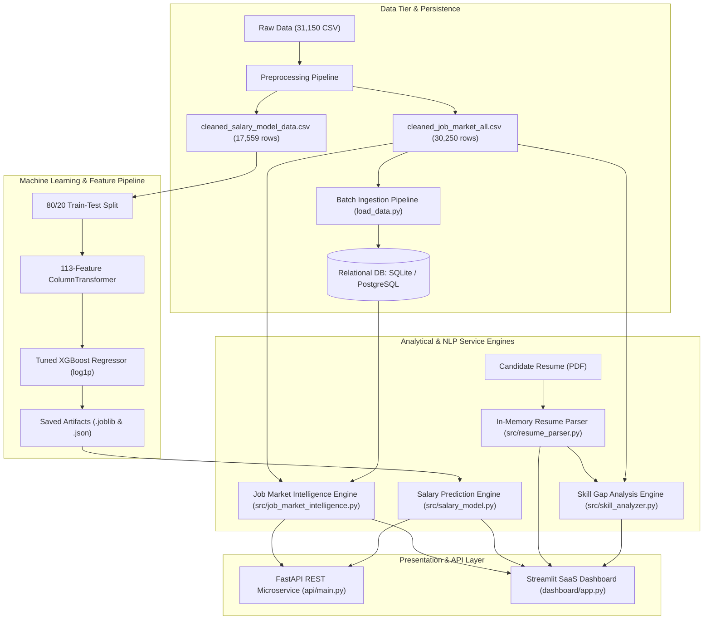
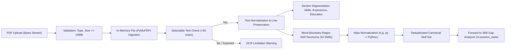
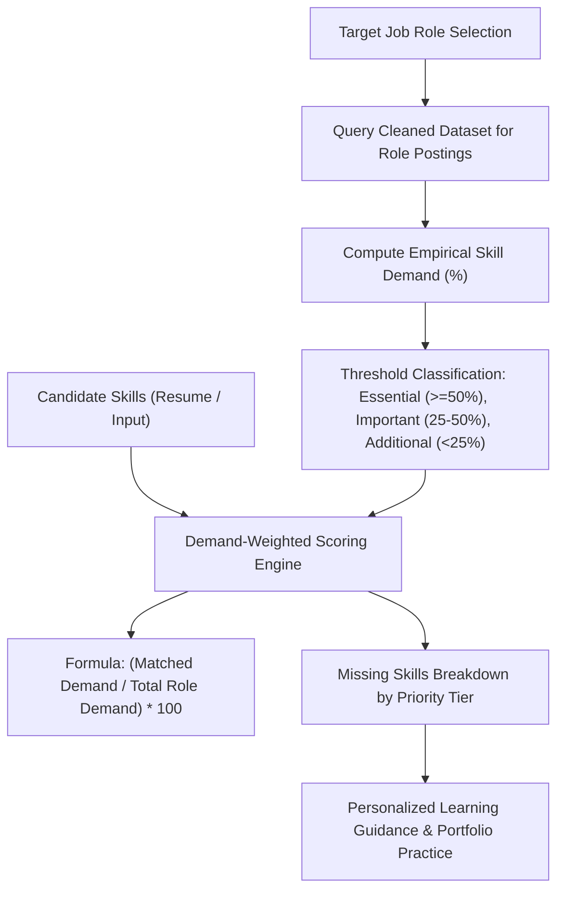
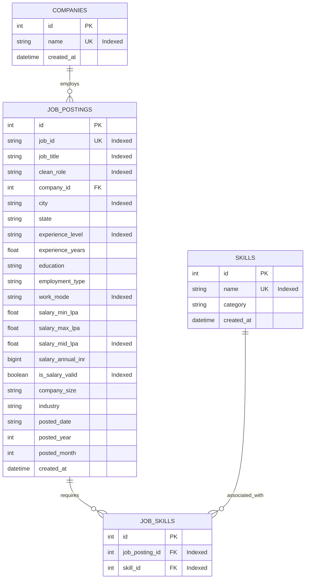

# Project System Architecture & Data Flow
## AI-Powered Job Market Intelligence & Salary Prediction System

**Document Version:** 1.0.0  
**Status:** Completed & Validated  

---

## 1. System Architecture Overview

The **AI-Powered Job Market Intelligence & Salary Prediction System** is structured as an enterprise-grade multi-tier Data Science application. The architecture cleanly decouples machine learning inference, natural language document processing, relational persistence, RESTful API delivery, and modern SaaS user interfaces.

---

## 2. End-to-End Data Flow

1. **Ingestion & Preprocessing:**
   - The uncleaned dataset (`india_job_market_messy_31150_records.csv`) contains 31,150 rows.
   - Exact deduplication eliminates 900 rows, yielding 30,250 unique records.
   - Text fields are stripped and normalized; job titles are mapped via `ROLE_NORMALIZATION_MAP` into 12 canonical roles.
   - Missing salary disclosures (12,145 postings) are preserved for overall market demand analytics, while high-integrity rows (17,559 records) are filtered into the salary modeling set.
2. **Feature Engineering & Transformation:**
   - Numerical features (`experience_years`, `skill_count`) are transformed via `RobustScaler`.
   - Categorical features (`job_title`, `city`, `state`, `experience_level`, `work_mode`, `employment_type`, `education`, `company_size`, `industry`) are one-hot encoded with `handle_unknown='ignore'`.
   - Technical skills are multi-hot encoded using a `MultiLabelBinarizer` covering the top 25 canonical market skills.
   - Total transformed feature dimensionality is **113 features**.
3. **Model Inference:**
   - Point estimates are predicted using the champion Tuned XGBoost Regressor fitted on `log1p(salary_mid_lpa)`:
     $$\hat{y} = \exp\left( f_{\text{XGB}}(x) \right) - 1$$
   - Prediction intervals are derived from empirical test residuals ($s_{\text{resid}} = 4.53\text{ LPA}$):
     $$\text{CI}_{90\%} = \left[ \hat{y} - 1.645 \cdot s_{\text{resid}}, \; \hat{y} + 1.645 \cdot s_{\text{resid}} \right]$$

---

## 3. Natural Language Processing & Resume Parsing Workflow

---

## 4. Skill Gap Analysis & Recommendation Architecture

---

## 5. Relational Database Entity-Relationship Diagram

---

## 6. Service Integration & Resilience

1. **Dual Service Delivery:**
   - **Interactive Frontend:** Streamlit (`dashboard/app.py`) provides human-interactive exploration, forms, file uploads, and Plotly charts.
   - **REST Microservice:** FastAPI (`api/main.py`) exposes JSON endpoints for programmatic integration.
2. **Database Fallback:**
   - Both interfaces connect through `database/db.py`.
   - If PostgreSQL credentials fail or the server is unavailable, the system automatically runs on local SQLite (`sqlite:///./data/job_market.db`).
   - The active database engine is disclosed on the Streamlit sidebar and API `/health` endpoint.
3. **Memory Caching:**
   - Streamlit utilizes `@st.cache_data` for heavy DataFrame aggregations and `@st.cache_resource` for initialized machine learning predictors and NLP parsers, preventing redundant computations.

